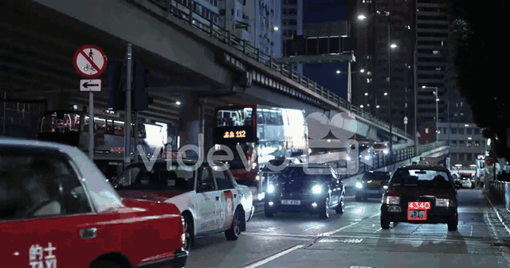

# Automatic Number Plate Recognition (YOLOv9 + EasyOCR)
Detects vehicle license plates with a custom-trained YOLOv9 (GELAN-C) model and reads the plate text with EasyOCR (validation mAP@0.5 = 0.994, mAP@0.5:0.95 = 0.851).

▶️ [Full demo video](assets/anpr_demo.mp4) · [Sample image results](assets/sample_results.jpg) · [Test videos](test_videos) · Train on Kaggle or Colab with [this notebook](notebooks/ANPR_YOLOv9_Kaggle_Colab.ipynb)
Run: clone [SkalskiP/yolov9](https://github.com/SkalskiP/yolov9) here, `pip install -r yolov9/requirements.txt -r requirements.txt`, then `python main.py --weights best.pt --source video.mp4 --save-csv`.
